# WoodyVisual User Guide

**WoodyVisual** is a web resource for exploring gene expression in the developing wood of several woody plants. It is designed for plant researchers, students, and anyone who wants a guided way to look at cells, genes, and public datasets.

[Open WoodyVisual](https://festival-openings-manufacturer-artistic.trycloudflare.com/). This preview link may change when the site restarts.

## Try your first gene query

Use this example to see where a gene is expressed in *Populus trichocarpa* (`Ptr`). You can follow it even if you do not have a gene ID of your own.

1. On WoodyVisual, open **Analysis Tools → Single-Species**.
2. Under **Select a Species**, choose **Populus trichocarpa (Ptr)**. Leave **All Subgroups** and **Gene mode** selected.
3. When the gene list is ready, open **Select Gene(s)**, search for `Potri.010G193100.v4.1`, and click the matching entry to select it. Click outside the dropdown to close it.
4. Click **Plot Graphs**. In the **UMAP** tab, the left map shows cell types and the right map shows expression of the selected gene. Each dot is one cell. On the right, stronger colour indicates higher expression and grey indicates zero detected expression.
5. Open **Data Table → Download CSV** to save the results of this query.

See [Single-Species](#3-single-species) for the other plot types and settings.

---

## Choose a page

| If you want to... | Start here | Then go to... |
|---|---|---|
| See where one gene is expressed | [Single-Species](#3-single-species) | **Data Table → Download CSV** to save your results. |
| See cell counts and cluster marker genes | [Clusters (Cell Counts and DEGs)](#2-clusters-cell-counts-and-degs) | **Single-Species** to check a marker gene. |
| Compare related genes between species | [OG Table](#7-og-table) | **Multi-Species** to plot the group. |
| Compare normal, tension, and opposite xylem | [Ptr Multi-Condition](#5-ptr-multi-condition) | **Download** to look up sample details. |
| Compare single-cell profiles with LCM reference profiles | [LCM Correlation](#6-lcm-correlation) | **Data Table** to see the correlation values. |
| Start from wood cell-wall genes | [SCW Biosynthesis Genes](#8-scw-biosynthesis-genes) | **Single-Species** to plot a gene from the list. |
| Find a public dataset or accession number | [Download](#9-download) | **Raw Data** or **Processed Data** for the sample you want. |

---

## A few helpful words

| Word on the website | Plain-language meaning |
|---|---|
| **SDX** | Stem-differentiating xylem, the developing wood in the stem. |
| **Cell type** | A label assigned to cells based on their expression profiles and biological evidence. |
| **UMAP** | Uniform Manifold Approximation and Projection. It places cells with similar expression profiles near each other in a two-dimensional map. |
| **Gene ID** | The database name for a gene. It is often more reliable than a short gene symbol. |
| **Barcode** | The identifier used to find a cell in the selected dataset. |
| **OG** | Ortholog group. A group of genes descended from a common ancestral gene that can include several members from one species. |
| **UMI** | Unique molecular identifier. Raw UMI counts estimate the number of captured RNA molecules for a gene in a cell. |
| **DEGs** | Differentially expressed genes. |
| **Ray lineage** | The developmental path that gives rise to ray parenchyma cells in the radial system of wood. |
| **Fusiform lineage** | The developmental path that gives rise to cells in the axial system of wood, including vessel elements and libriform fibers in many angiosperms. |
| **SCW** | Secondary cell wall, the strong wall that many wood cells build as they mature. |
| **LCM** | Laser capture microdissection, a method for isolating selected cells or regions from tissue sections for RNA profiling. |

The names and ideas used here follow the woody-plant cell work described by Tung et al. (2023) and the study of normal, tension, and opposite xylem in *Populus* by Hsieh et al. (2025). See [Scientific background](#scientific-background) for the papers.

---

## 1. Home

The Home page introduces the database and the species it contains. Use it to decide whether WoodyVisual includes the plant and type of question you care about.

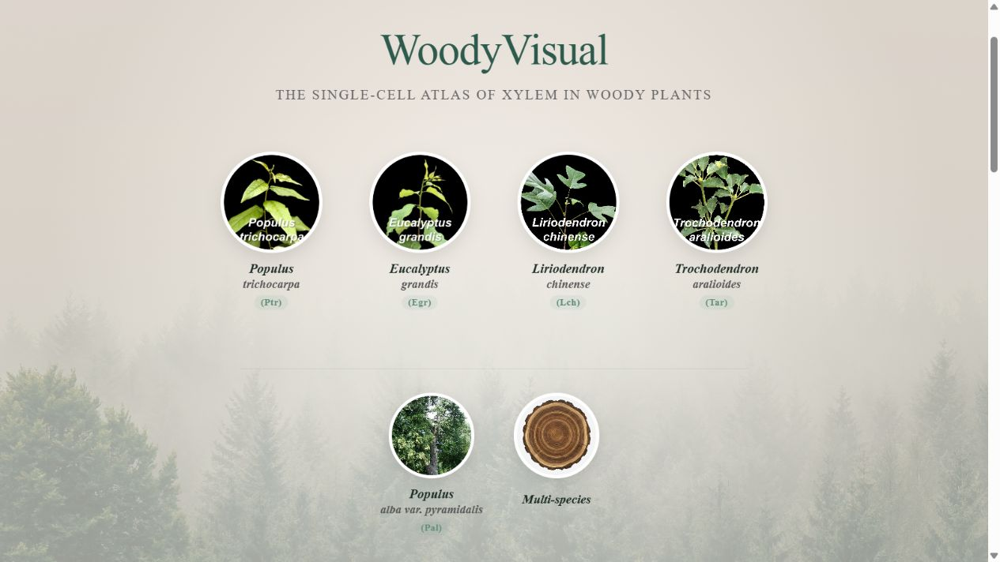

### How to use it

1. Read the short introduction and check the available species.
2. Open **Analysis Tools** in the top menu for **Single-Species**, **Multi-Species**, or **Ptr Multi-Condition**. The other tools are linked directly from the top menu.

The species listed on Home are *Populus trichocarpa* (`Ptr`), *Eucalyptus grandis* (`Egr`), *Liriodendron chinense* (`Lch`), *Trochodendron aralioides* (`Tar`), and *Populus alba* var. *pyramidalis* (`Pal`).

---

## 2. Clusters (Cell Counts and DEGs)

Use **Clusters** to see how many cells are assigned to each lineage and cluster, and to look up marker genes for individual clusters.

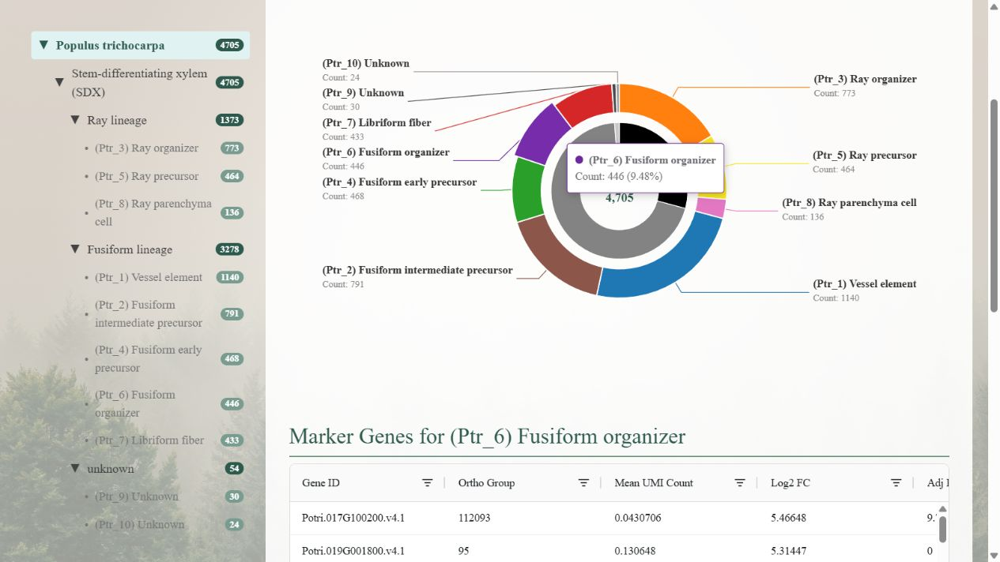

### How to use it

1. Choose `Ptr`, `Egr`, `Lch`, or `Tar` under **Select Species**. For `Pal` gene expression, use **Single-Species**.
2. Use the tree and ring chart to see counts by lineage and cluster. Hover over a slice to see its cell count and percentage.
3. Click a cluster slice in the outer ring to open its **Marker Genes** table below the chart. For example, select `(Ptr_6) Fusiform organizer`.
4. Read **Gene ID**, **Ortho Group**, **Mean UMI Count**, **Log2 FC** (log₂ fold change), and **Adj P-Value**. Take a Gene ID to **Single-Species** to see its expression across clusters.

### Read this page carefully

The number of cells shown is the number captured in this dataset. It is not automatically the true proportion of cells in a living stem. Sample preparation can make some cell types easier to collect than others.

If you see an `unknown` group, treat it as a group that has not yet been given a confident name. Do not assume it belongs to the nearest named group.

---

## 3. Single-Species

Single-Species shows expression of selected genes or ortholog groups in one species. It also lets you inspect the gene profile of one cell.

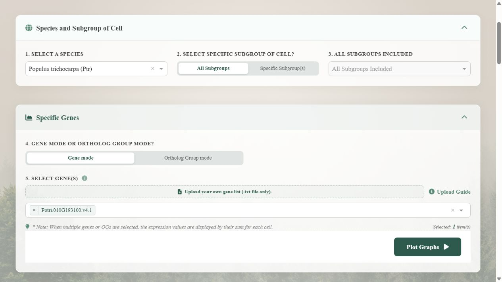

### Step-by-step

1. Under **Select a Species**, choose your plant. For example, choose `Ptr` for *Populus trichocarpa*.
2. Keep **All Subgroups** for an overview. To limit the analysis, click **Specific Subgroup(s)** and choose the cell groups in the dropdown.
3. Choose **Gene mode** for a Gene ID or **Ortholog Group mode** for an OG ID. Wait for the list to load, then open the selector, search for the ID, and click the matching entry. For a versioned Gene ID such as `Potri.010G193100.v4.1`, you can leave off the `.v4.1` suffix when searching.
4. Click **Plot Graphs**. When you select multiple genes or OGs, the plot uses their summed expression per cell.
5. Open **UMAP**, **Violin & Box Plots**, or **Data Table** to see the corresponding results.

### What you will see

- **UMAP** shows the cell-type map alongside the expression map. Click a cell in the cell-type map to see its barcode, cell type, and top 10 genes.
- **Violin & Box Plots** show expression distributions by cell group. The plots use a log scale that includes zeros. Hover to see summary values and cell counts.
- **Data Table** lists the cells and expression values for the current view. Use **Download CSV** to save the table.

### Useful tips

- Start with **Raw UMI** and **All** cells to see the full distribution. **Normalized** adjusts for sequencing depth and excludes cells without a normalization factor. **Expressing only** excludes zero-expression cells from the expression view, distribution summaries, and data table.
- The upload control accepts plain-text (`.txt`) lists of Gene IDs in **Gene mode** or OG IDs in **Ortholog Group mode**. Use one ID per line or follow the separators shown in **Upload Guide**.
- Use **Export Plot** to choose the format, dimensions, resolution, and background for a plot. Format availability depends on the plot type.

### View one cell’s gene profile

Click a dot in the left UMAP and choose **View full gene profile**. If you already have a barcode, scroll below the results to **Whole Transcriptome**, choose it under **Select a Cell**, and click **Plot Gene Profile**. The profile shows nonzero raw UMI counts and lets you choose how many top-expressed genes to display in the bar chart.

---

## 4. Multi-Species

Multi-Species shows the summed expression of an ortholog group across a selected combination of woody plants. Use **OG Table** to look up its member genes for that combination.

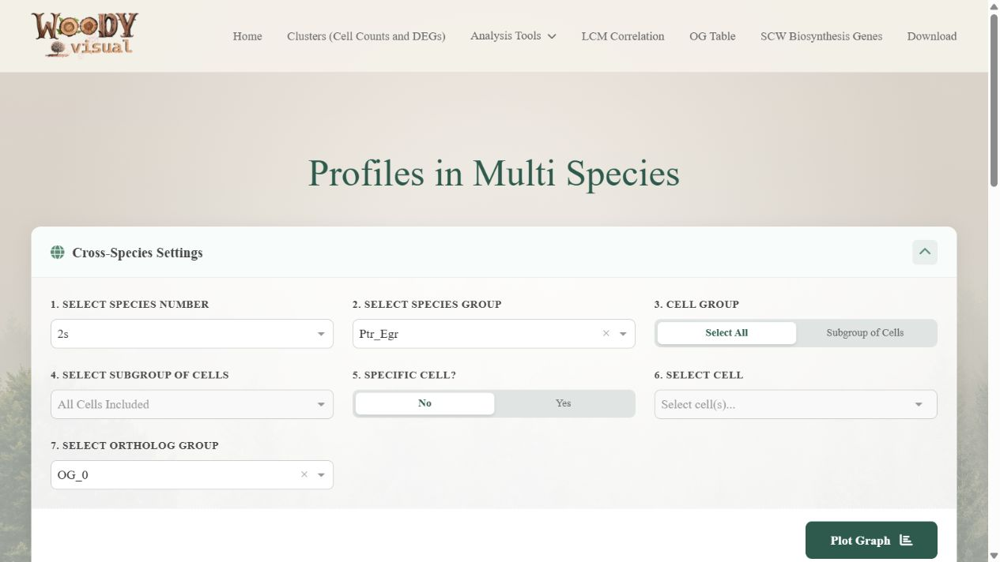

### Step-by-step

1. Open **Analysis Tools → Multi-Species**. For a first run, choose `2s` under **Select Species Number** and `Ptr_Egr` under **Select Species Group**.
2. Leave **Cell Group** set to **Select All** and **Specific Cell?** set to **No**.
3. Under **Select Ortholog Group**, choose `OG_0` and click **Plot Graph**.
4. In **UMAP**, use **Highlight** to focus on `Ptr` or `Egr`. Use **Data Table → Download CSV** to save the cell-level values.

Use **Raw UMI** or **Normalized** to choose how expression is displayed, and **All** or **Expressing only** to choose which cells are included in the expression results.

For a narrower query, use **Subgroup of Cells** and choose the cell groups, or set **Specific Cell?** to **Yes** and choose cells under **Select Cell**. The site supports two-, three-, and four-species OG comparisons. The `5s` option is unavailable because `Pal` has no ortholog data in the site.

### How to read the result

The plot is a comparison aid. Before describing a pattern as “shared between species”, check:

1. Does each species have one gene in the OG, or several?
2. Are you comparing the same broad cell type and using the same expression setting in both species?
3. Do the member genes show a similar pattern when checked individually in **Single-Species**?

Cells placed close together on a combined map are not automatically the same cell type. Use the map together with cell names, known marker genes, and biological knowledge of wood development.

---

## 5. Ptr Multi-Condition

This page compares gene or OG expression across normal, tension, and opposite xylem samples from *Populus trichocarpa*.

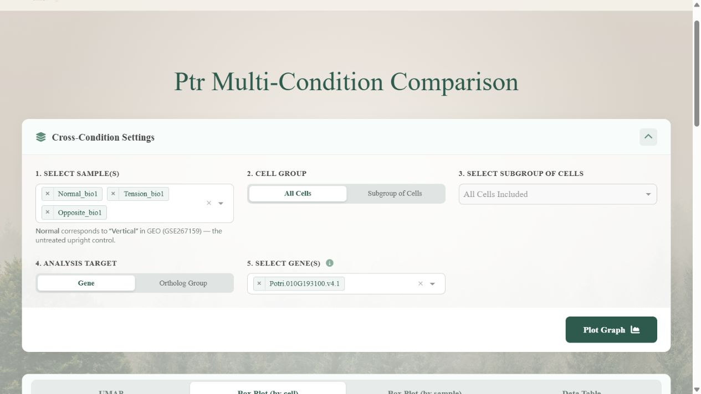

### Step-by-step

1. Open **Analysis Tools → Ptr Multi-Condition**. Under **Select Sample(s)**, choose `Normal_bio1`, `Tension_bio1`, and `Opposite_bio1` to follow the example. **Normal** corresponds to **Vertical** in GEO (`GSE267159`), the untreated upright control.
2. Leave **Cell Group** set to **All Cells**. To focus on a cell type, choose **Subgroup of Cells** and use **Select Subgroup of Cells**.
3. Under **Analysis Target**, choose **Gene**, then search for and select `Potri.010G193100.v4.1` under **Select Gene(s)**. For an OG query, choose **Ortholog Group** and select an OG instead.
4. Click **Plot Graph**. Open **UMAP** to see the cell-type and expression maps, or use **Data Table → Download CSV** to save the cell-level values and sample labels.
5. Open **Box Plot (by cell)** to see the distribution across individual cells, or **Box Plot (by sample)** to compare biological replicates across conditions.

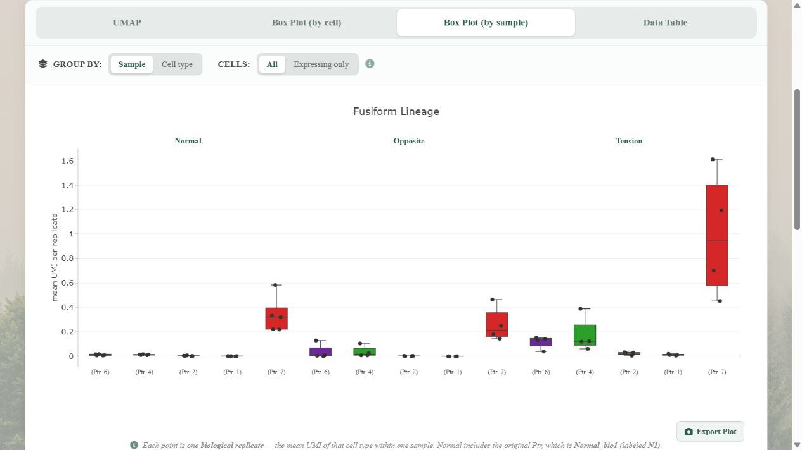

### How to read it

The by-sample view loads all available biological replicates for the condition comparison. Each point is the mean UMI count for one cell type in one biological replicate. `Normal_bio1` is the original `Ptr` sample, labelled `N1` in the plots.

Hsieh et al. (2025) compared xylem from upright controls with tension xylem and xylem from the opposite side of bent *Populus* stems. The study found differences in developmental timing and cell-type proportions.

### Important reminder

Check the number of biological replicates in the by-sample view before interpreting a condition difference. Use **Download** to confirm sample metadata. **Expressing only** restricts the displayed values to cells with positive expression and can change the summaries.

---

## 6. LCM Correlation

LCM Correlation compares single-cell expression profiles from *Populus trichocarpa* with LCM RNA-seq reference profiles for libriform fibers, vessel elements, and ray parenchyma cells.

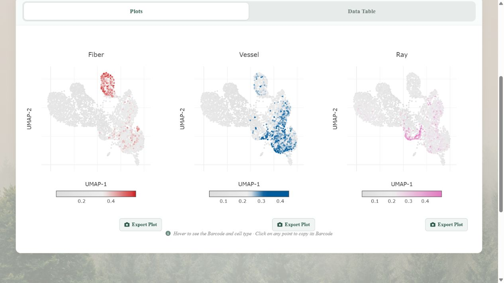

### Step-by-step

1. Open **LCM Correlation**. The current page is for *Populus trichocarpa*.
2. In the **Plots** tab, compare the three maps labelled **Fiber**, **Vessel**, and **Ray**.
3. Use each colour bar to read the correlation values. Hover over a point to see its barcode and cell type, or click it to copy the barcode.
4. Open **Data Table** to see the **Fiber**, **Vessel**, and **Ray** values for each barcode. Use **Download CSV** to save the table.

### How to use the information

Use these correlations together with cluster annotations and marker-gene expression. A higher correlation indicates a closer match to that reference expression profile.

---

## 7. OG Table

OG Table is the place to find related genes before making a cross-species plot. It helps answer: “What is the matching gene group in another plant?”

[Open OG Table](https://festival-openings-manufacturer-artistic.trycloudflare.com/og-table)

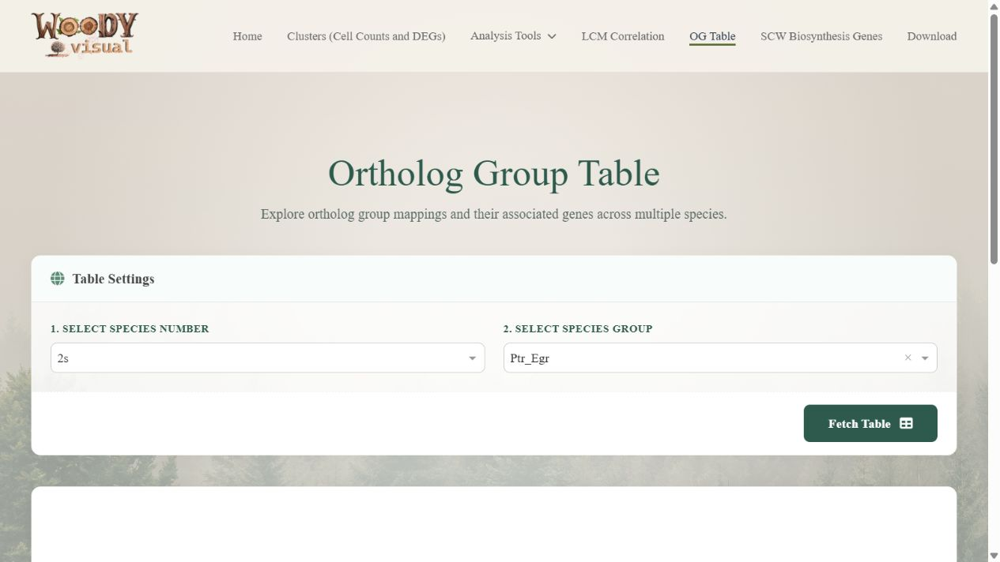

### Step-by-step

1. In **Select Species Number**, choose how many species you want to compare. Use `2s` for a first comparison.
2. In **Select Species Group**, choose a pair, such as `Ptr_Egr`.
3. Click **Fetch Table** and wait for the table to appear.
4. Read the **OrthologGroup (OG)**, **Species**, and **Mapped Genes** columns.
5. Expand `... (+N)` to see more members. Click a Gene ID to copy it or use the copy button for the whole row.
6. Use **Download CSV** to save the table. To plot an OG in **Multi-Species**, use the same species combination and select that OG.

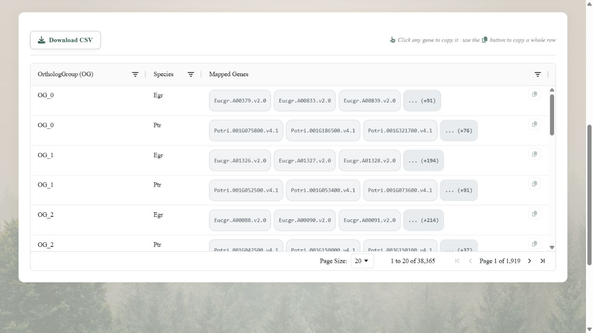

### How to use a large table

For a large species combination, filter **Mapped Genes** or search the downloaded CSV for the Gene ID you already know. Check how many genes the matching OG contains in each species.

### A simple rule

If one species has several genes in the same OG, do not call them all “the same gene”. They are related, but each may have taken on a different role.

---

## 8. SCW Biosynthesis Genes

This page lists *Populus trichocarpa* genes associated with secondary cell wall biosynthesis. Use it to find candidates related to cellulose, hemicellulose, or lignin.

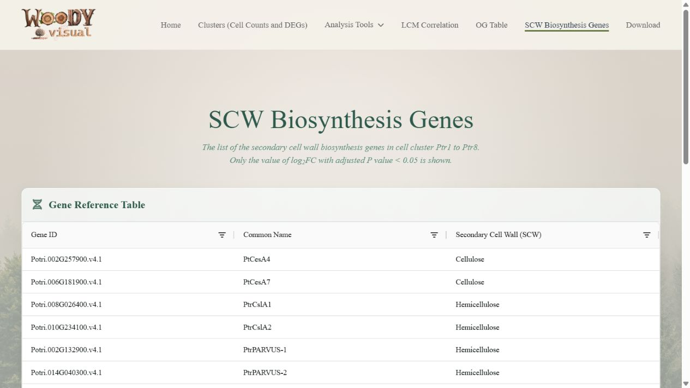

### Step-by-step

1. In **Gene Reference Table**, browse **Gene ID**, **Common Name**, and **Secondary Cell Wall (SCW)**. Use a column filter to narrow the list.
2. Note the Gene ID of a gene that interests you, such as `Potri.002G257900.v4.1` (`PtCesA4`) for cellulose.
3. Open **Single-Species**, select `Ptr`, and plot the gene to see which cells express it.
4. Use **OG Table** to look up related genes in another species.

### How to read the list

This page tells you that a gene is a useful **candidate** for a cell-wall question. It does not, on its own, show that the gene is active in every wood cell or in your chosen sample. Always check the gene in Single-Species.

---

## 9. Download

Use **Download** to find the public datasets behind the website. To save results from a plot you made, open **Data Table** on that analysis page and click **Download CSV**.

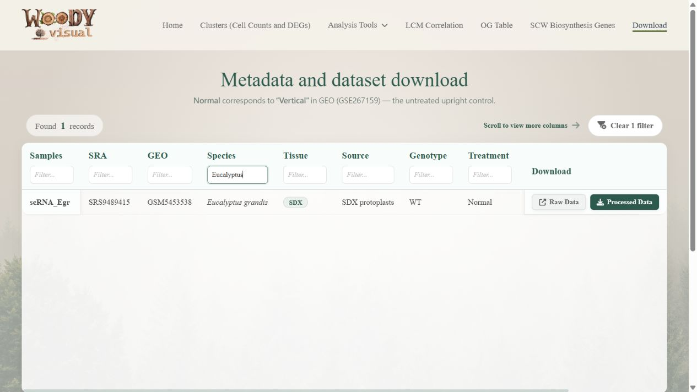

### Step-by-step

1. Open **Download** in the top menu. Type a species name into the **Filter...** field below the **Species** header.
2. Add a filter under another column, such as **Tissue** or **Treatment**, to narrow the results.
3. Scroll the table horizontally as needed to check the sample name, SRA/GEO accession, tissue, source, genotype, treatment, data type, and technology.
4. Use **Raw Data** to reach the original sequencing records or **Processed Data** to download the prepared files for the sample.
5. Save the accession number and citation information with your project notes.

### Example

Type `Eucalyptus` in the **Species** filter to find `scRNA_Egr`. The row lists SDX protoplasts, `WT`, `Normal`, and `MARS-seq2.0`, with SRA accession `SRS9489415` and GEO accession `GSM5453538`.

### Before downloading

Check that the species, tissue, sample condition, and data type match your question. Keep the dataset version and the original accession number: both are important when you later share or publish your analysis.

---

## Common questions

### I clicked a button and no plot appeared. What should I do?

Check that you selected a species, species group, or sample as required. Wait for the target list to finish loading, select a gene or OG, close any open menu, and click the plot button again. If the page reports that the list failed to load, click **Retry**.

### Can I say that a gene is “specific” to one cell type from one plot?

Use careful language. A plot can show that a gene is **mainly seen** in one group in this dataset. For a stronger claim, check more than one dataset, read the original paper, and compare with known biology.

### Can I compare gene values from two different species directly?

Use the comparison as a guide, not as an exact measurement. First make sure the genes are related in the OG Table, then consider differences in sampling, gene copies, and how the data were prepared.

### Why do some cells have no visible signal for a gene?

A zero count means the assay detected no RNA molecules for that gene in that cell. Limited RNA capture can also produce zeros, so check the pattern across cells.

---

## Scientific background

This guide uses the cell names and biological context of the following studies:

1. Tung, C.-C., Kuo, S.-C., Yang, C.-L. *et al.* **Single-cell transcriptomics unveils xylem cell development and evolution.** *Genome Biology* 24, 3 (2023). The study used single-cell RNA-seq and laser capture microdissection RNA-seq to describe ray and fusiform lineages in stem-differentiating xylem across four woody angiosperms. [Read the article](https://doi.org/10.1186/s13059-022-02845-1).
2. Hsieh, J.-W. A., Liou, P.-C., Lin, C.-C. *et al.* **Single-cell and spatial multiomics identifies heterogeneous xylem development driven by mechanical stress in Populus.** *Developmental Cell* 60, 3131–3148.e8 (2025). The study examined normal, tension, and opposite xylem in *Populus*. [Read the article](https://doi.org/10.1016/j.devcel.2025.06.038).

These papers provide the biological background for understanding ray cells, fusiform cells, fibre and vessel development, and tension wood. They should be cited when their results or terminology are used in a report or publication.
